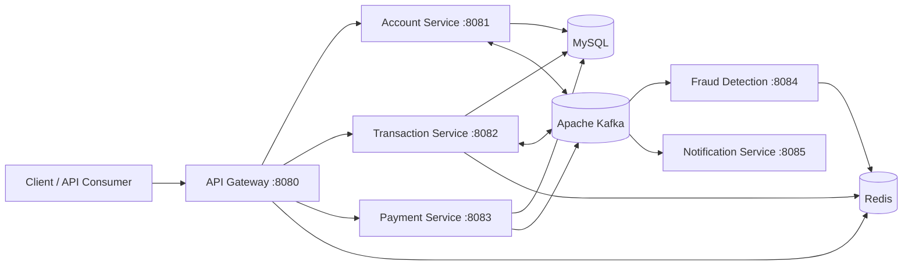

# Banking System


An event-driven banking platform built as a collection of independently deployable Spring Boot microservices. The system demonstrates account management, money transfers, payment-order creation, asynchronous notifications, fraud checks, and operational safeguards such as gateway rate limiting and health endpoints.

> **Project status:** Educational/portfolio project designed to demonstrate production-oriented backend architecture. Before production use, configure secrets through an external secret manager, add authentication/authorization, enforce TLS, and harden database and message-broker settings.

## Architecture



### Services

| Service | Port | Responsibility |
| --- | ---: | --- |
| `api-gateway` | `8080` | Central entry point, route forwarding, Redis-backed request rate limiting, actuator gateway visibility |
| `account-service` | `8081` | Account creation, account lookup, balance operations, blocking, and transfer balance steps |
| `transaction-service` | `8082` | Transfers, transaction history, OTP verification, and Saga-style transfer orchestration |
| `payment-service` | `8083` | Razorpay order creation and webhook processing |
| `fraud-detection-service` | `8084` | Kafka-driven transaction risk checks using configurable velocity and amount thresholds |
| `notification-service` | `8085` | Kafka consumer for asynchronous notification processing and email integration |

## Key Engineering Highlights

- **Microservice boundaries:** Separate services own accounts, transactions, payments, fraud detection, and notifications.
- **Event-driven workflows:** Kafka producers and consumers decouple transaction processing from fraud and notification workloads.
- **Saga-style transfer flow:** Transaction processing coordinates balance deduction, fraud evaluation, completion, and compensating credit operations.
- **API gateway controls:** Spring Cloud Gateway centralizes routing and applies service-specific Redis rate limits.
- **Data persistence:** MySQL with Spring Data JPA and service-specific databases.
- **Payment integration:** Razorpay order creation and webhook handling are isolated in the payment service.
- **Operational visibility:** Spring Boot Actuator exposes health and information endpoints.
- **Local infrastructure:** Docker Compose provisions MySQL, Redis, Kafka, and ZooKeeper for development.
- **Validation and testing:** Jakarta Bean Validation, Maven Wrapper builds, and Spring Boot test modules are included per service.

## Technology Stack

| Area | Technology |
| --- | --- |
| Language | Java 17 |
| Application framework | Spring Boot, Spring MVC/WebFlux |
| Cloud components | Spring Cloud Gateway, OpenFeign |
| Messaging | Apache Kafka |
| Databases | MySQL, Spring Data JPA |
| Caching and rate limiting | Redis |
| Payments | Razorpay Java SDK |
| Build | Maven Wrapper |
| Infrastructure | Docker Compose |
| Development | IntelliJ IDEA, Lombok |

## Getting Started

### Prerequisites

- Java 17+
- Docker Desktop with Docker Compose
- Git
- A Razorpay test account if payment flows are being exercised

### 1. Start infrastructure

From the repository root:

```bash
docker compose up -d
```

This starts MySQL, Redis, Kafka, and ZooKeeper. Allow the containers a few seconds to become healthy before starting the applications.

### 2. Configure local secrets

Do not commit database passwords, Razorpay keys, mail credentials, or webhook secrets. Replace the local values in the service configuration with environment-variable or external-secret references before sharing or deploying the project.

For Docker Compose, copy `.env.example` to `.env` and replace each placeholder with the appropriate secret. For services started outside Compose, export `DB_PASSWORD` and the Razorpay variables in the shell before running the Maven Wrapper. The `.env` file is ignored by Git.

At minimum, configure:

- MySQL credentials and connection settings
- Razorpay test `key-id`, `key-secret`, and webhook secret
- Mail server credentials for notification delivery
- Kafka and Redis connection settings for non-local environments

### 3. Run the services

Open a terminal for each service and run its Maven Wrapper:

```bash
cd account-service
./mvnw spring-boot:run
```

On Windows, use `mvnw.cmd spring-boot:run`. Repeat for `api-gateway`, `transaction-service`, `payment-service`, `fraud-detection-service`, and `notification-service`.

To build and test an individual service:

```bash
cd account-service
./mvnw clean verify
```

## API Overview

The gateway exposes the primary REST routes:

| Method | Endpoint | Purpose |
| --- | --- | --- |
| `POST` | `/api/v1/accounts` | Create an account |
| `GET` | `/api/v1/accounts/{accountNumber}` | Retrieve account details |
| `GET` | `/api/v1/accounts/{accountNumber}/balance` | Retrieve current balance |
| `POST` | `/api/v1/transactions/transfer` | Initiate a transfer |
| `GET` | `/api/v1/transactions/{transactionId}` | Retrieve a transaction |
| `GET` | `/api/v1/transactions/account/{accountNumber}` | Retrieve transaction history |
| `POST` | `/api/v1/transactions/{transactionId}/verify?otp=...` | Verify a transaction OTP |
| `POST` | `/api/v1/payments/create-order` | Create a Razorpay payment order |
| `POST` | `/api/v1/payments/webhook` | Receive a Razorpay webhook |

Service health endpoints are available through each application's actuator endpoint:

```text
http://localhost:8080/actuator/health
```

## Repository Structure

```text
.
├── api-gateway/
├── account-service/
├── transaction-service/
├── payment-service/
├── fraud-detection-service/
├── notification-service/
├── docker-compose.yml
└── LICENSE
```

Each service is independently buildable and contains its own Maven project, application configuration, source code, and tests.

[//]: # (## Resume-Ready Project Summary)

[//]: # ()
[//]: # (**Banking System | Java, Spring Boot, Kafka, MySQL, Redis, Docker**)

[//]: # ()
[//]: # (- Designed and implemented a six-service banking platform with independent account, transaction, payment, fraud, notification, and gateway components.)

[//]: # (- Built an event-driven transaction workflow with Kafka consumers/producers and Saga-style compensating operations for balance consistency.)

[//]: # (- Implemented Spring Cloud Gateway routing with Redis-backed rate limiting and Actuator health visibility.)

[//]: # (- Integrated Razorpay order creation and webhook processing while separating payment concerns from core transaction processing.)

[//]: # (- Containerized local infrastructure with Docker Compose for MySQL, Redis, Kafka, and ZooKeeper.)

[//]: # ()
[//]: # (## Security Notes)

[//]: # ()
[//]: # (This repository is for development and demonstration. Never commit real credentials or production configuration. Rotate any credential that has previously been committed, move secrets to environment variables or a secret manager, validate and authenticate webhooks, and add an identity provider with role-based authorization before production deployment.)

## License

Distributed under the terms of the [MIT License](LICENSE).
